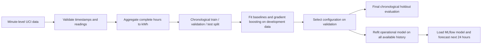

# Household Electricity Consumption Forecasting

An hourly time-series forecasting project using the UCI Individual Household
Electric Power Consumption dataset. The goal is to forecast the next 24 hourly
energy values from past consumption and calendar features, without weather
data.

> **Historical demonstration only:** the source data covers December 2006 to
> November 2010. The saved model and example forecast describe that historical
> dataset; they are not forecasts of current household consumption.

## Dataset and target

The source dataset contains 2,075,259 minute-level records. The raw file is
expected at `data/raw/household_power_consumption.txt` and is never modified by
the project.

`Global_active_power` is measured in kilowatts. For each hour with all 60
minute-aligned readings present and valid, the hourly target is calculated as:

```text
hourly energy (kWh) = sum of the 60 minute power readings (kW) / 60
```

The timeline retains missing hourly targets. Hours with missing readings,
misaligned timestamps, or fewer than 60 observations are not imputed or used as
complete hourly targets. The resulting series contains 34,085 valid hourly
targets over 34,589 hourly slots.

## Exploratory views

The full series and its gaps are visible in this descriptive overview. It is
not a plot of the final test predictions.


The calendar profiles show average consumption by hour and weekday in the
historical dataset. They are exploratory summaries, not evidence that these
patterns will remain stable in another period.


## Forecasting workflow



The reusable pipeline is in `src/energy_forecasting/`:

- `data.py` validates the minute data and creates the hourly target.
- `features.py` creates cyclical hour-of-day and day-of-week features, plus
  1-hour and 24-hour consumption lags.
- `models.py` implements a previous-day seasonal-naive baseline, a weekday-hour
  average baseline, and a recursive `HistGradientBoostingRegressor` forecast.
- `evaluation.py` provides chronological splitting, metrics, and selection of
  complete daily forecast windows.
- `run_experiments.py` compares candidate models on validation and records the
  runs in MLflow.
- `evaluate_final.py` contains the one-time final holdout evaluation. **Do not
  rerun it for dashboard development or model tuning.**
- `train_model.py` fits the operational model on all available history and
  logs its artifact in MLflow without calculating test metrics.
- `predict.py` loads a trusted MLflow model artifact and generates 24 hourly
  predictions.

## Evaluation results

The modeling pipeline uses chronological 70/15/15 training, validation, and
test periods. Hyperparameter selection used validation. Final test scores are
from 193 complete daily rolling-origin windows (4,632 hourly predictions per
method); each forecast uses only observations available before that day's
origin.

| Method | Test MAE (kWh) | Test RMSE (kWh) |
|---|---:|---:|
| Previous-day seasonal naive | 0.5040 | 0.7554 |
| Weekday-hour average | 0.5108 | 0.6790 |
| Gradient boosting | **0.4765** | **0.6314** |

The gradient boosting model had the lowest MAE and RMSE among these methods on
this evaluation. The final test period was not used to fit the selected model
or select its hyperparameters. However, the dataset and an earlier overlapping
80/20 prototype holdout were examined during exploration. The final result is
therefore a chronological holdout evaluation, **not a fully blind test**.
Historical prototype results are documented separately in
[`reports/forecasting_results.md`](reports/forecasting_results.md) and should
not be confused with these final pipeline results.

The operational model is a separate artifact trained on all available
historical data so it can produce a demonstration forecast. Its predictions
are not the predictions used to calculate the final test metrics.

## Setup (Ubuntu / WSL)

From the project root, create and activate a virtual environment and install
the development and MLflow dependencies:

```bash
python3 -m venv venv
source venv/bin/activate
python -m pip install -e ".[dev,tracking]"
```

Run the automated test suite:

```bash
python -m pytest tests
```

## Train and predict

Train and log an operational model in the local MLflow tracking store:

```bash
python -m energy_forecasting.train_model
```

The command prints a model URI in the form `runs:/<run-id>/model`. Copy the
URI from your own training output; do not assume that another machine has the
same run ID.

Use that URI to create a CSV containing the next 24 hourly predictions:

```bash
python -m energy_forecasting.predict \
  --model-uri "runs:/<run-id>/model" \
  --output /tmp/previsions_24h.csv
```

Prediction requires 24 consecutive complete hourly targets immediately before
the forecast origin. An incomplete trailing hour is not imputed; forecasting
starts after the latest complete hour. Missing values within the required
history cause an explicit error.

## MLflow

Runs and model artifacts are stored locally in `mlflow.db` and `mlruns/`.
These local experiment files are excluded from version control. To open the
MLflow UI from the project root:

```bash
mlflow ui \
  --backend-store-uri sqlite:///mlflow.db \
  --host 127.0.0.1 \
  --port 5000
```

Then open <http://127.0.0 .1:5000>. Validation experiments, the recorded final
evaluation, and the operational model run have different purposes; check each
run's name and tags before interpreting its metrics or artifacts.

## Limitations and responsible interpretation

- The source dataset ends in November 2010. Forecast dates from this dataset
  are historical demonstrations, not current predictions.
- The final holdout period was previously seen during exploratory work; do
  not describe it as fully unseen or blind.
- The final metrics summarize one chronological period and may not generalize
  to other households or time periods.
- Evaluation uses complete daily rolling-origin windows, not one uninterrupted
  six-month-ahead forecast.
- Missing and partial hours are not imputed; they reduce the number of usable
  training examples and evaluation windows.
- No weather, tariff, occupancy, or other external variables are used.
- A plausible-looking forecast profile does not establish predictive
  accuracy; use validation and the reported holdout metrics for that purpose.
- Do not tune the model or make modeling decisions based on the final test
  metrics.

## Project structure

```text
data/
  raw/                  Original source data (not committed)
  interim/
  processed/
notebooks/               Exploratory data analysis
reports/
  figures/               Existing exploratory charts
  forecasting_results.md Detailed results and methodology
src/energy_forecasting/  Reusable data, feature, model, and evaluation code
tests/                   Automated tests
dashboard/               Streamlit dashboard and display-data helpers
```

## Run the dashboard

Install the dashboard dependencies (including MLflow):

```bash
python -m pip install -e ".[dashboard]"
```

Set `FORECAST_MODEL_URI` to a trusted model URI printed by
`energy_forecasting.train_model`, then start the app:

```bash
export FORECAST_MODEL_URI="runs:/<run-id>/model"
python -m streamlit run dashboard/app.py
```

Open the local URL printed by Streamlit. The app reads the existing final-test
metrics from MLflow and displays them with an explicit warning that the
holdout period was previously examined. It does not run training or
evaluation. Only load trusted model artifacts created by this project.
