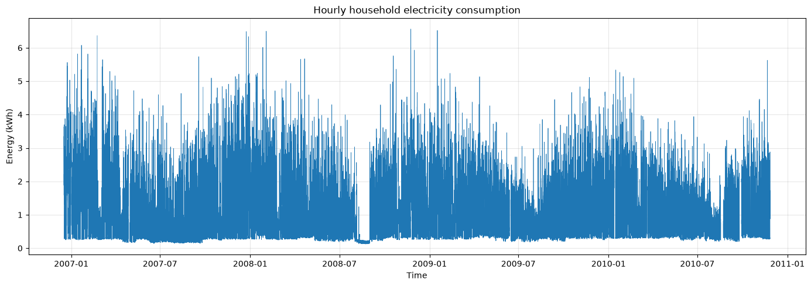
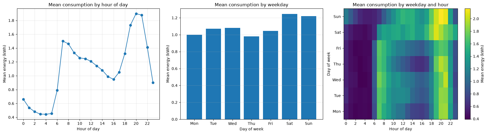
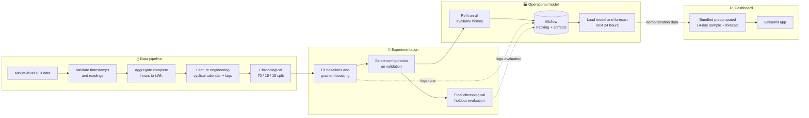

<div align="center">

# ⚡ Household Electricity Forecasting

**Hourly, 24-step-ahead energy forecasting with a leakage-aware, chronologically validated, MLflow-tracked pipeline — built on the UCI Individual Household Electric Power Consumption dataset.**

<br>


[](https://github.com/lintello-10/energy_consumption_forecasting/actions/workflows/tests.yml)

<br>

[🚀 Live Demo](#live-demonstrations) • [🏗️ Architecture](#architecture) • [⚙️ Getting Started](#getting-started) • [📊 Evaluation Results](#evaluation-results) • [⚠️ Limitations](#limitations)

</div>

---

> [!WARNING]
> **Historical demonstration only.** The source data covers **December 2006 – November 2010**. The saved model and the example forecast describe that historical dataset; they are **not** forecasts of current household consumption.

<details>
<summary><b>📚 Full Table of Contents</b></summary>

<br>

1. [📌 Overview](#overview)
   - [Dataset and target](#dataset-and-target)
   - [Exploratory views](#exploratory-views)
   - [Time-series diagnostics](#time-series-diagnostics)
2. [🚀 Live Demonstrations](#live-demonstrations)
3. [🏗️ Architecture](#architecture)
4. [🧰 Technologies Used](#technologies-used)
5. [📂 Repository Structure](#repository-structure)
6. [⚙️ Getting Started](#getting-started)
7. [🚀 Train and Predict](#train-and-predict)
8. [📊 Evaluation Results](#evaluation-results)
9. [🔬 MLflow Tracking](#mlflow-tracking)
10. [🖥️ Run the Dashboard](#run-the-dashboard)
11. [🚧 Limitations and Responsible Interpretation](#limitations)

</details>

---

<a id="overview"></a>
## 📌 Overview

This project forecasts the **next 24 hourly energy values** of a single household from its **past consumption and calendar features only** — no weather data, tariffs, or occupancy signals.

| | |
|---|---|
| **Task** | Multi-step (24 h) hourly energy forecasting |
| **Inputs** | Past hourly consumption (1 h and 24 h lags) + cyclical calendar features |
| **Champion model** | Recursive `HistGradientBoostingRegressor` |
| **Baselines** | Previous-day seasonal naive · weekday-hour average |
| **Validation** | Chronological 70/15/15 split, rolling-origin daily windows |
| **Tracking** | MLflow (validation runs, final evaluation, operational model) |
| **Data window** | December 2006 – November 2010 (historical) |

### Dataset and target

The source dataset contains **2,075,259 minute-level records**. The raw file is expected at `data/raw/household_power_consumption.txt` and is **never modified** by the project.

`Global_active_power` is measured in kilowatts. For each hour in which all 60 minute-aligned readings are present and valid, the hourly target is:

```text
hourly energy (kWh) = sum of the 60 minute power readings (kW) / 60
```

| Statistic | Value |
|---|---:|
| Minute-level records | 2,075,259 |
| Hourly slots in the timeline | 34,589 |
| Valid hourly targets | 34,085 |

- The timeline **retains missing hourly targets**.
- Hours with missing readings, misaligned timestamps, or fewer than 60 observations are **never imputed** and never used as complete hourly targets.

### Exploratory views

The full series and its gaps are shown below. This is a **descriptive overview**, not a plot of the final test predictions.



The calendar profiles show average consumption by hour and weekday in the historical dataset. They are exploratory summaries, **not** evidence that these patterns remain stable in another period.



### Time-series diagnostics

Exploratory ADF and KPSS tests were applied to the **longest uninterrupted segment** of an earlier training portion of the series.

- Results were compatible with **trend-stationarity** for that segment — this does **not** establish stationarity of the full series.
- The detrended ACF showed **short-term dependence**, recurring peaks around **daily lags**, and a positive association at a **weekly lag**.
- These are descriptive diagnostics: they are neither proof of forecast performance nor automatic model-selection rules.

📓 See the [exploratory notebook](notebooks/Exploratory_Data_Analysis.ipynb) and the [detailed results and methodology](reports/forecasting_results.md) for scope and interpretation.

---

<a id="live-demonstrations"></a>
## 🚀 Live Demonstrations

| Demo | Description | Link |
|---|---|---|
| 📈 **Streamlit Dashboard** | Interactive exploration of a bundled, precomputed 14-day historical sample, its 24-hour forecast, and the published evaluation summary | [**Open the live demo →**](https://energyconsumptionforecasting-9ejqpwflvhxzergfsympin.streamlit.app/) |

> [!NOTE]
> The hosted app **does not generate new predictions**. Its controls explore a fixed historical demonstration, and the evaluation page clearly labels the previously examined chronological holdout.

---

<a id="architecture"></a>
## 🏗️ Architecture



**Key design principle:** the *final holdout evaluation* and the *operational model* are deliberately separate paths.

| Path | Purpose | Fitted on | Produces |
|---|---|---|---|
| 🧪 **Validation experiments** | Compare candidates and select hyperparameters | Training period | Validation metrics (MLflow) |
| 🎯 **Final evaluation** | One-time chronological holdout assessment | Development data | Test MAE / RMSE |
| 🏭 **Operational model** | Produce a demonstration forecast | **All** available history | A model artifact — **no test metrics** |

---

<a id="technologies-used"></a>
## 🧰 Technologies Used

| Domain | Technologies |
|---|---|
| 🖥️ **Dashboard** |  |
| 🤖 **Machine Learning** |  `HistGradientBoostingRegressor` ·   |
| 🔬 **Experiment Tracking** |  (local SQLite backend + model artifacts) |
| ✅ **Testing & CI** |   |
| 🐍 **Language** |  |

---

<a id="repository-structure"></a>
## 📂 Repository Structure

```text
.
├── data/
│   ├── raw/                      # Original source data (not committed, never modified)
│   ├── interim/                  # Intermediate artifacts
│   └── processed/                # Processed datasets
│
├── notebooks/
│   └── Exploratory_Data_Analysis.ipynb   # Descriptive EDA and ADF/KPSS/ACF diagnostics
│
├── reports/
│   ├── figures/                  # Exploratory charts (global series, calendar patterns)
│   └── forecasting_results.md    # Detailed results and methodology
│
├── src/energy_forecasting/
│   ├── data.py                   # Minute-data validation and hourly kWh target
│   ├── features.py               # Cyclical hour/weekday features + 1 h and 24 h lags
│   ├── models.py                 # Seasonal-naive, weekday-hour average, recursive HGBR
│   ├── evaluation.py             # Chronological split, metrics, daily window selection
│   ├── run_experiments.py        # Validation comparison, logged to MLflow
│   ├── evaluate_final.py         # ⚠️ One-time final holdout evaluation
│   ├── train_model.py            # Operational model on all history (no test metrics)
│   └── predict.py                # Loads a trusted MLflow model → 24 hourly predictions
│
├── tests/                        # Automated test suite (pytest)
│
└── dashboard/                    # Streamlit app and display-data helpers
    └── app.py
```

> [!CAUTION]
> `evaluate_final.py` implements the **one-time** final holdout evaluation. **Do not rerun it** for dashboard development or model tuning.

---

<a id="getting-started"></a>
## ⚙️ Getting Started

> Tested workflow for **Ubuntu / WSL**. Run all commands from the project root.

**1. Create and activate a virtual environment**

```bash
python3 -m venv venv
source venv/bin/activate
```

**2. Install the package with development and tracking dependencies**

```bash
python -m pip install -e ".[dev,tracking]"
```

**3. Place the raw dataset**

```text
data/raw/household_power_consumption.txt
```

**4. Run the automated test suite**

```bash
python -m pytest tests
```

---

<a id="train-and-predict"></a>
## 🚀 Train and Predict

**1. Train and log the operational model** in the local MLflow tracking store:

```bash
python -m energy_forecasting.train_model
```

**2. Retrieve the model URI** printed by the command, in the form:

```text
runs:/<run-id>/model
```

> [!IMPORTANT]
> Copy the URI from **your own** training output. Do not assume another machine shares the same run ID.

**3. Generate the next 24 hourly predictions** as a CSV file:

```bash
python -m energy_forecasting.predict \
  --model-uri "runs:/<run-id>/model" \
  --output /tmp/previsions_24h.csv
```

**Input requirements**

- Prediction requires **24 consecutive complete hourly targets** immediately before the forecast origin.
- An **incomplete trailing hour is not imputed**: forecasting starts after the latest complete hour.
- Missing values within the required history raise an **explicit error**.

---

<a id="evaluation-results"></a>
## 📊 Evaluation Results

### Protocol

| Element | Design choice |
|---|---|
| **Split** | Chronological 70 / 15 / 15 (train / validation / test) |
| **Model selection** | Hyperparameters chosen on the **validation** period only |
| **Test protocol** | **193 complete daily rolling-origin windows** (4,632 hourly predictions per method) |
| **Leakage control** | Each forecast uses only observations available **before that day's origin** |
| **Metrics** | MAE and RMSE, in kWh |

### Test-period results

| Method | Test MAE (kWh) | Test RMSE (kWh) |
|---|---:|---:|
| Previous-day seasonal naive | 0.5040 | 0.7554 |
| Weekday-hour average | 0.5108 | 0.6790 |
| **Gradient boosting** | **0.4765** | **0.6314** |

Gradient boosting achieved the **lowest MAE and RMSE** among the three methods on this evaluation.

### How to read these numbers

- ✅ The final test period was **not** used to fit the selected model or to select its hyperparameters.
- ⚠️ The dataset and an earlier, overlapping 80/20 prototype holdout **were examined during exploration**. The result is therefore a *chronological holdout evaluation*, **not a fully blind test**.
- 🔀 The **operational model** is a separate artifact trained on all available history to produce a demonstration forecast. Its predictions are **not** the predictions used to compute the final test metrics.
- 📄 Historical prototype results are documented separately in [`reports/forecasting_results.md`](reports/forecasting_results.md) and must not be confused with these final pipeline results.

---

<a id="mlflow-tracking"></a>
## 🔬 MLflow Tracking

Runs and model artifacts are stored locally in `mlflow.db` and `mlruns/`. These local experiment files are **excluded from version control**.

Launch the MLflow UI from the project root:

```bash
mlflow ui \
  --backend-store-uri sqlite:///mlflow.db \
  --host 127.0.0.1 \
  --port 5000
```

Then open **<http://127.0.0.1:5000>**.

| Run type | Purpose |
|---|---|
| 🧪 Validation experiments | Candidate comparison and hyperparameter selection |
| 🎯 Recorded final evaluation | One-time chronological holdout assessment |
| 🏭 Operational model run | Artifact trained on all available history |

> [!TIP]
> These runs serve **different purposes**. Check each run's **name and tags** before interpreting its metrics or artifacts.

---

<a id="run-the-dashboard"></a>
## 🖥️ Run the Dashboard

```bash
python -m pip install -e ".[dashboard]"
python -m streamlit run dashboard/app.py
```

The dashboard reads a **bundled, precomputed 14-day historical sample** and its 24-hour forecast, plus the published evaluation summary. At runtime it does **not** need the raw dataset, an MLflow tracking database, or a model URI.

---

<a id="limitations"></a>
## 🚧 Limitations and Responsible Interpretation

> [!WARNING]
> **Temporal scope** — The source dataset ends in **November 2010**. Forecast dates are historical demonstrations, **not** current predictions.

> [!WARNING]
> **Holdout status** — The final holdout period was previously seen during exploratory work. Do **not** describe it as fully unseen or blind.

> [!NOTE]
> **Generalization** — The final metrics summarize **one chronological period** of **one household** and may not transfer to other households or time periods.

> [!NOTE]
> **Evaluation design** — Evaluation uses complete **daily rolling-origin windows**, not one uninterrupted six-month-ahead forecast.

> [!NOTE]
> **Missing data** — Missing and partial hours are **not imputed**; they reduce the number of usable training examples and evaluation windows.

> [!NOTE]
> **No external variables** — No weather, tariff, occupancy, or other exogenous features are used.

> [!IMPORTANT]
> **Plausibility ≠ accuracy** — A plausible-looking forecast profile does not establish predictive accuracy. Rely on validation results and the reported holdout metrics.

> [!CAUTION]
> **No test-driven tuning** — Do **not** tune the model or make modeling decisions based on the final test metrics.

---

<div align="center">

⚡ *Built with rigor: chronological validation, no leakage, no silent imputation.* ⚡

</div>
